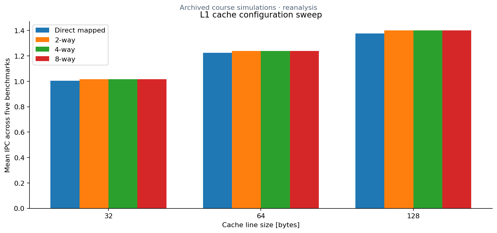
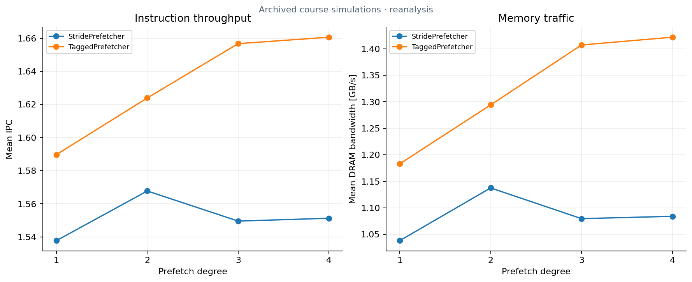

# Computer architecture experiments

Three HY425 assignments from the University of Crete explore branch prediction, out-of-order CPU resources, and memory-hierarchy design using gem5 simulation results.



*Recomputed from the supplied statistics: arithmetic mean IPC across five course benchmarks. These are archived simulation results, not new gem5 runs.*

**C++ · gem5 predictor interfaces · Python · performance analysis · LibreOffice Calc · Matplotlib**

| Assignment | Engineering work | Explore |
| --- | --- | --- |
| 1 · Branch prediction | GAg and PAg predictor source, saturating counters, history tables, predictor comparisons | [Source, report, results](assignments/01_branch_prediction) |
| 2 · CPU resources | LSQ/ROB capacity, functional-unit counts, throughput and diminishing returns | [Workbook, report, analysis](assignments/02_cpu_resources) |
| 3 · Memory hierarchy | Cache lines, associativity, replacement/inclusion policies, and prefetching | [Data, scripts, report](assignments/03_memory_hierarchy) |

[Run guide](docs/SETUP.md) · [Technical brief report](docs/report.pdf) · [Overleaf ZIP](docs/report-overleaf.zip)

## Run the analysis

```sh
python3 -m pip install -r requirements.txt
python3 tools/analyze.py
python3 tools/plot_results.py
python3 -m unittest discover -s tests -v
```

CSV tables, a structured JSON summary, and plots are written under `build/`. No simulator installation is needed for this workflow. The parser reads original branch counters, numeric cells from the CPU workbook, and compressed cache-statistics records. It validates benchmark coverage and recomputes means from the five workloads.

The supplied evidence covers **20 branch-predictor runs**, **25 CPU workbook rows**, and **370 memory runs across 74 configurations**. Cache experiments include 12 L1 configurations, 54 L2 configurations, and eight prefetcher configurations, each with five benchmarks. Original PDF reports and editable documents remain available in each assignment folder.

## Throughput and memory traffic



*Prefetch degree changes both IPC and DRAM traffic. Bandwidth is in decimal GB/s, converted from the saved byte-per-second counter. Comparisons describe this benchmark collection only.*

The work connects low-level predictor state, architectural resource choices, and reproducible analysis of simulator output. The archived CPU study uses sequential parameter tuning, so its groups are not an exhaustive independent factorial search.

The complete course gem5 tree, benchmark programs, parameter declarations, and launch configurations were not supplied. The original C++ predictors are retained for inspection, with a PAg indexing concern documented in [setup](docs/SETUP.md#predictor-source-boundaries). The analysis is runnable, while fresh simulator execution is not claimed.

Coursework source and reports identify **Dimitris Asimakopoulos, csd4845**. gem5 is an external simulator dependency, not an implementation supplied by this repository.
