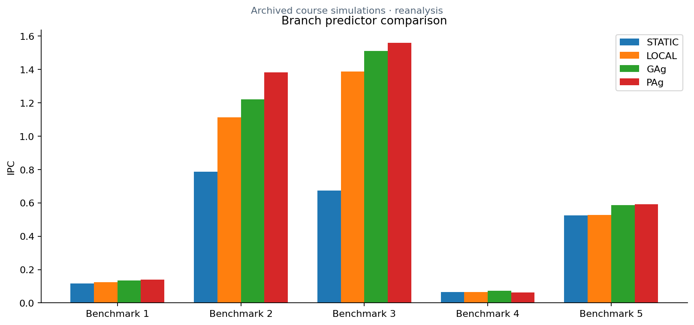

# Branch prediction

The GAg predictor combines a global outcome-history register with a shared pattern table. PAg selects per-address local history and uses it to index a shared prediction table. The source shows counter updates, taken/not-taken decisions, history shifts, and skipped wrong-path updates.

**C++ · gem5 BPredUnit · saturating counters · Python counter analysis**

*Analysis of historical course simulation evidence, not new simulator runs.*

The archived comparison covers static, local, GAg, and PAg predictors on five benchmarks. The raw counter dump supports 20 records. The extra GAg history-length comparison in the original report has no corresponding raw dump here. PAg indexing requires review before integration, as detailed in the setup guide.

[Original course report](cs425_sim1.pdf) · [Run instructions and metric definitions](../../docs/SETUP.md) · [Collection](../../README.md)

[Global-history source](GAgPredictor.cc) · [Per-address-history source](PAgPredictor.cc) · [Original counter dump](all_stats.txt).
