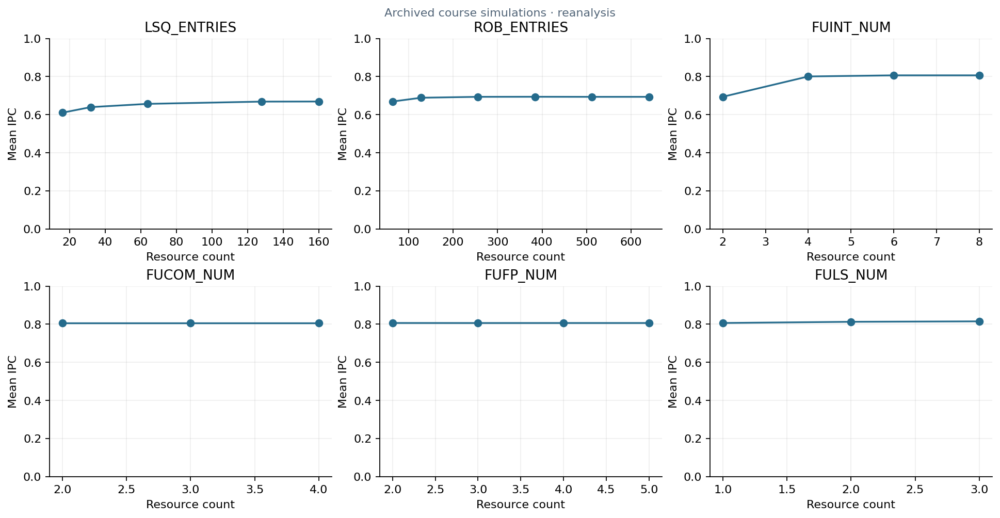

# Out-of-order CPU resource study

This experiment varies load/store queues, the reorder buffer, and integer, floating-point, and load/store execution units. It compares throughput gains against resource growth and discusses diminishing returns.

**gem5 results · LibreOffice Calc · Python XML/ZIP parsing · Matplotlib**

*Analysis of historical course simulation evidence, not new simulator runs.*

The parser exports 25 parameter rows and verifies each average against its five benchmark cells. The report describes sequential tuning, so later parameter groups retain earlier settings. The plotted groups are not independent sweeps from one shared initial baseline. MiP is a course cost proxy, not measured power or silicon area.

[Original course report](sim2_report.pdf) · [Run instructions and metric definitions](../../docs/SETUP.md) · [Collection](../../README.md)

[Editable results workbook](sim2_stats.ods) · [Editable original report](sim2_report.odt).
