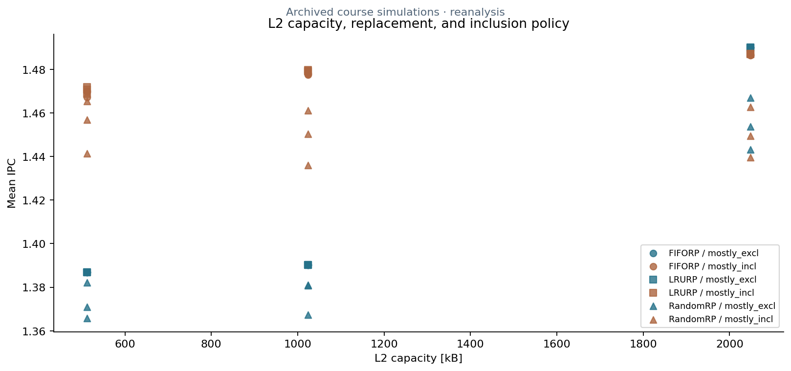

# Caches and prefetching

Three sweeps investigate L1 cache-line size/associativity, L2 capacity/replacement/inclusion, and prefetcher type/degree. The data contains 74 configurations per benchmark, with five benchmarks and 370 complete saved statistics files.

**gem5 statistics · Python · gzip/JSONL · CSV · Matplotlib**

*Analysis of historical course simulation evidence, not new simulator runs.*

The compressed data retains the original statistics text and configuration labels. The current parser exports both L1D and L2 miss rates under their actual counter names, plus IPC and DRAM bytes/second. Original student extraction scripts and the manually entered chart script remain as historical reference. Use the portable central tools for reproduction.

[Original course report](report_sim3.pdf) · [Run instructions and metric definitions](../../docs/SETUP.md) · [Collection](../../README.md)

[Editable workbook](sim3.ods) · [Compressed evidence](data) · [Original scripts](scripts).
